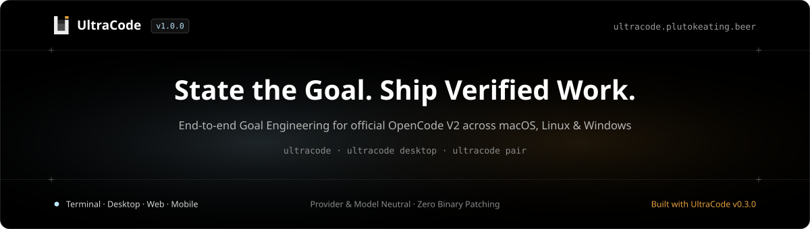
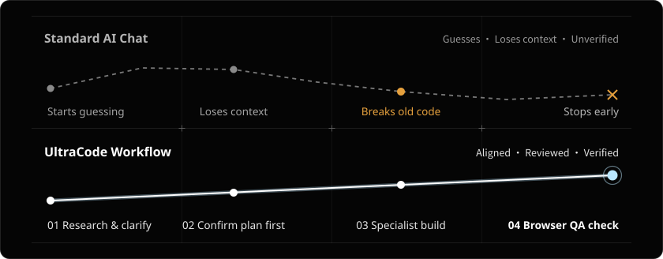
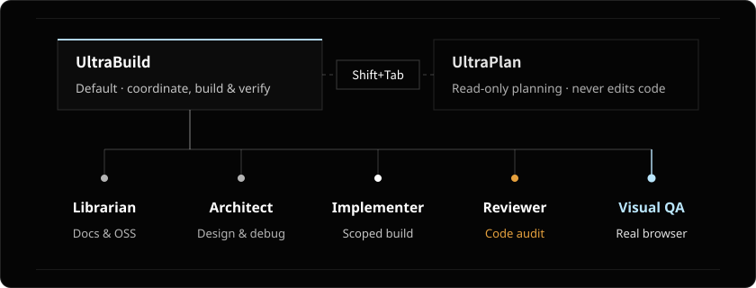

<div align="center">

<a href="https://ultracode.plutokeating.beer">
  
</a>

<br />

[](https://github.com/PlutoKeating/Project.UltraCode/releases/latest)
[](https://ultracode.plutokeating.beer)
[](https://ultracode.plutokeating.beer/docs/getting-started/)
[](https://github.com/PlutoKeating/Project.UltraCode/releases/tag/v1.0.0)
[](https://github.com/PlutoKeating/Project.UltraCode/actions/workflows/ci.yml)

**English** · [简体中文](README_ZH.md) · [العربية](README_AR.md) · [Français](README_FR.md) · [Русский](README_RU.md) · [Español](README_ES.md)

[Official Website](https://ultracode.plutokeating.beer) • [1-Minute Quick Start](https://ultracode.plutokeating.beer/docs/getting-started/) • [Architecture](docs/ARCHITECTURE.md) • [CLI Reference](docs/API.md)

</div>

**UltraCode (`v1.1.0`)** is a non-invasive, provider- and model-neutral **Goal Engineering** layer built on official **OpenCode V2** across **macOS, Linux, and Windows** — spanning **Terminal (TUI), Desktop App, Web, and Mobile**.

Instead of guessing early or drifting halfway through multi-step tasks, UltraCode clarifies open requirements upfront with structured choice cards, delegates work across specialized background agents, inspects rendered UI in a real Chromium browser, and saves durable handoffs inside your repository.

> [!NOTE]
> **Self-hosted engineering provenance:** UltraCode `v1.1.0` — including its OpenCode `v2.4+` runtime alignment, durable milestone checkpoints, and upstream stewardship canary — was developed and built with **UltraCode `v1.0.0`**.

## Overview

<div align="center">
  
</div>

### Key Capabilities

- **One Command, Zero Prerequisites**: A single `ultracode` CLI with full `opencode` flag and subcommand passthrough. Both the installer and `ultracode upgrade` automatically detect, install, or update official OpenCode V2 (`v2.3.2+`, verified on `v2.4+`).
- **Every Surface Synchronized**: Embedded `ultracode-conversation` plugin syncing live state across Server RPC, TUI Command Palette, OpenCode Desktop (`ComposerPill` with one-click milestone clear & `Settings → UltraCode`), and Web/Mobile (`/approvals` and `/direction`).
- **Two Primary Roles + Five Specialists**: Switch anytime with `Shift+Tab` between `UltraBuild` (end-to-end delivery) and `UltraPlan` (strictly read-only planning), backed automatically by `librarian`, `architect`, `implementer`, `reviewer`, and `visual-evaluator`.
- **Long-Running Continuation & Handoffs**: Advances durable session milestones automatically with stall circuit breakers and official `/goal` coexistence, yields immediately when you send a new message, and resumes across restarts from repository handoff files; includes a cross-platform TypeScript `ultracode ralph run` runner.
- **Strictly Additive & Reversible**: Never patches official OpenCode binaries, never reads or transmits your API keys, preserves existing JSONC comments and custom skills, and uninstalls cleanly.

<div align="center">
  
</div>

## Getting Started

### 1. One-Line Install

**macOS / Linux**:

```bash
curl -fsSL https://ultracode.plutokeating.beer/install.sh | bash
```

**Windows (PowerShell)**:

```powershell
irm https://ultracode.plutokeating.beer/install.ps1 | iex
```

> [!TIP]
> You do not need to pre-install Node.js, Bun, or OpenCode. If official OpenCode V2 is missing, the installer sets it up automatically from the official release channel.

### 2. Launch on Any Surface

```bash
ultracode           # Open the terminal interface in the current directory
ultracode desktop   # Launch OpenCode Desktop (or download the official installer if missing)
ultracode pair      # Generate a pairing link & QR code for browser or mobile access
```

- **Role Toggle**: Press `Shift+Tab` to switch between `UltraBuild` (default) and `UltraPlan` (read-only planning).
- **Live Autonomy Switches**: Toggle **Command approvals** (`auto` by default) and **Direction questions** (`manual` by default) from the OpenCode Desktop `UltraCode` composer pill, `Settings → UltraCode`, the TUI Command Palette, or `/approvals` and `/direction` on Web and Mobile.

## CLI Reference

| Command | Description |
| --- | --- |
| `ultracode [args...]` | Launch OpenCode with full flag, path, and subcommand passthrough |
| `ultracode desktop` | Open official OpenCode Desktop or download the platform installer |
| `ultracode pair [--remote]` | Pair a browser or mobile client via link and QR code |
| `ultracode upgrade` | Update official OpenCode V2 and UltraCode together, then sync |
| `ultracode sync` | Idempotently sync configuration, plugin, roles, and managed runtime |
| `ultracode doctor` | Verify OpenCode version, plugin state, roles, and MCP health (zero model calls) |
| `ultracode ralph run <goal>` | Run isolated fresh-session Ralph iterations inside a linked Git worktree |
| `ultracode uninstall --yes` | Remove UltraCode cleanly while preserving user configs and backups |

## Repository Structure

```text
Project.UltraCode/
├── packages/
│   ├── installer/      # Unified ultracode CLI, JSONC union merger & 6-target standalone builder
│   ├── plugin-gui/     # OpenCode Desktop GUI plugin (ComposerPill & SettingsPage)
│   └── config/         # Embedded OpenCode roles, Server/TUI/RPC conversation plugin & Ralph templates
├── scripts/            # Zero-prerequisite installers (install.sh, install.ps1) & 6-locale brand asset generator
├── website/            # Astro + Starlight 6-language website & docs (ultracode.plutokeating.beer)
└── docs/               # Architecture, CLI API, Quick Start, Cloudflare guide & 6-locale SVG/OG assets
```

## Local Verification

```bash
bun install --cwd packages/plugin-gui
bun run --cwd packages/plugin-gui check
bun run --cwd packages/plugin-gui build

bun install --cwd packages/installer
bun test --cwd packages/installer
bun run --cwd packages/installer check
bun run --cwd packages/installer build

bun install --cwd website
bun run --cwd website check
bun run --cwd website build
```

> [!IMPORTANT]
> Automated tests run entirely against isolated temporary directories and local stubs — never invoking live AI models or reading personal credentials.

## Documentation

- **Official Website & Guides** ([English](https://ultracode.plutokeating.beer) · [简体中文](https://ultracode.plutokeating.beer/zh/) · [العربية](https://ultracode.plutokeating.beer/ar/) · [Français](https://ultracode.plutokeating.beer/fr/) · [Русский](https://ultracode.plutokeating.beer/ru/) · [Español](https://ultracode.plutokeating.beer/es/))
- [Architecture Overview](docs/ARCHITECTURE.md) · [CLI & Plugin API](docs/API.md) · [Quick Start](docs/QUICK_START.md) · [Cloudflare Deployment](docs/CLOUDFLARE.md)
- Machine-readable index for AI agents: [`llms.txt`](https://ultracode.plutokeating.beer/llms.txt) · [`llms-full.txt`](https://ultracode.plutokeating.beer/llms-full.txt)
