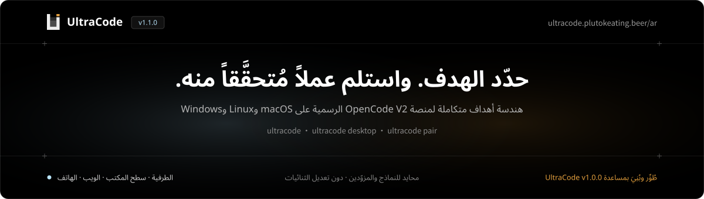
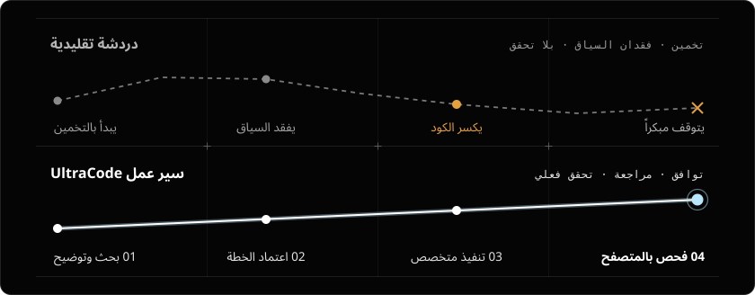
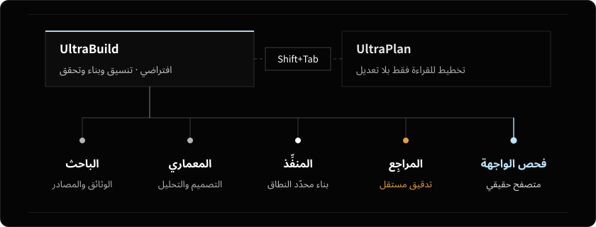

<div align="center">

<a href="https://ultracode.plutokeating.beer/ar/">
  
</a>

<br />

[](https://github.com/PlutoKeating/Project.UltraCode/releases/latest)
[](https://ultracode.plutokeating.beer/ar/)
[](https://ultracode.plutokeating.beer/ar/docs/getting-started/)
[](https://github.com/PlutoKeating/Project.UltraCode/releases/tag/v1.0.0)
[](https://github.com/PlutoKeating/Project.UltraCode/actions/workflows/ci.yml)

[English](README.md) · [简体中文](README_ZH.md) · **العربية** · [Français](README_FR.md) · [Русский](README_RU.md) · [Español](README_ES.md)

[الموقع الرسمي](https://ultracode.plutokeating.beer/ar/) • [دليل البدء في دقيقة](https://ultracode.plutokeating.beer/ar/docs/getting-started/) • [الأدوار وسير العمل](https://ultracode.plutokeating.beer/ar/docs/roles-and-workflow/) • [مرجع الأوامر](https://ultracode.plutokeating.beer/ar/docs/controls-and-maintenance/)

</div>

<div dir="rtl">

**UltraCode (`v1.1.0`)** هو طبقة تعزيز غير تدخلية ومحايدة تجاه النماذج والمزوّدين مبنية فوق **OpenCode V2** الرسمي، تركز على **هندسة الأهداف (Goal Engineering)** عبر أنظمة **macOS وLinux وWindows**، وتغطي **الطرفية (TUI) وتطبيق سطح المكتب والويب والهاتف المحمول**.

بدلاً من التخمين المبكر أو فقدان السياق في منتصف المهام المعقدة، يوضّح UltraCode المتطلبات مسبقاً عبر بطاقات اختيار منظّمة، وينسّق العمل بين خبراء متخصصين في الخلفية، ويفحص الواجهات فعلياً داخل متصفح Chromium حقيقي، ويحفظ ملفات التسليم داخل المستودع لاستئناف العمل بسلاسة.

</div>

> [!NOTE]
> **توثيق البناء الذاتي:** تم تطوير وبناء الإصدار الرسمي `UltraCode v1.1.0` (بما يشمل توافق OpenCode `v2.4+` واستمرارية المراحل ومراقبة التحديثات الآلية) بمساعدة **UltraCode `v1.0.0`**.

<div align="center">
  
</div>

<div dir="rtl">

## القدرات الرئيسية

- **أمر واحد دون متطلبات مسبقة**: يعمل الأمر الوحيد `ultracode` بتوافق كامل مع جميع معاملات وأوامر `opencode` الفرعية؛ كما يتكفّل المثبّت والأمر `ultracode upgrade` بتثبيت أو تحديث OpenCode V2 الرسمي (`v2.3.2+`، مُتحقَّق منه على `v2.4+`) تلقائياً.
- **مزامنة فورية عبر جميع الواجهات**: حزمة الإضافة `ultracode-conversation` توحّد الحالة لحظياً عبر الطرفية وتطبيق OpenCode Desktop (كبسولة التحكم السريعة مع مسح المرحلة التالية بنقرة واحدة وصفحة `Settings → UltraCode`) والويب والهاتف (`/approvals` و`/direction`).
- **دوران رئيسيان وخمسة خبراء في الخلفية**: بدّل في أي وقت عبر `Shift+Tab` بين `UltraBuild` (للتنفيذ المتكامل) و`UltraPlan` (للتخطيط للقراءة فقط)، بدعم تلقائي من `librarian` و`architect` و`implementer` و`reviewer` و`visual-evaluator`.
- **استمرارية المهام الطويلة والاستئناف السلس**: ينتقل بين المراحل تلقائياً، ويستجيب فوراً لأي رسالة جديدة، ويستأنف التقدّم بعد إعادة التشغيل مع مشغّل `ultracode ralph run` الأصيل.
- **إضافي بالكامل وقابل للإزالة النظيفة**: لا يعدّل الملفات التنفيذية الرسمية لـ OpenCode، ولا يقرأ مفاتيح API الخاصة بك، ويحافظ على إعداداتك ومهاراتك الحالية.

</div>

<div align="center">
  
</div>

<div dir="rtl">

## البدء السريع

### 1. التثبيت بأمر واحد

</div>

**macOS / Linux**:

```bash
curl -fsSL https://ultracode.plutokeating.beer/install.sh | bash
```

**Windows (PowerShell)**:

```powershell
irm https://ultracode.plutokeating.beer/install.ps1 | iex
```

> [!TIP]
> لا حاجة إلى تثبيت Node.js أو Bun أو OpenCode مسبقاً؛ في حال عدم وجود OpenCode V2 الرسمي سيقوم السكربت بتثبيته تلقائياً من القناة الرسمية.

<div dir="rtl">

### 2. التشغيل عبر أي واجهة

</div>

```bash
ultracode           # تشغيل واجهة الطرفية في المجلد الحالي
ultracode desktop   # فتح تطبيق سطح المكتب الرسمي أو تنزيل المثبّت تلقائياً
ultracode pair      # إنشاء رابط ورمز QR لربط المتصفح أو الهاتف المحمول
```

<div dir="rtl">

- **تبديل الدور الرئيسي**: اضغط `Shift+Tab` للتبديل بين `UltraBuild` (الافتراضي) و`UltraPlan` (تخطيط للقراءة فقط).
- **مفاتيح التحكم الفورية**: بدّل **موافقات الأوامر** (`auto` افتراضياً) و**أسئلة الاتجاه** (`manual` افتراضياً) عبر كبسولة `UltraCode` في سطح المكتب، أو `Settings → UltraCode`، أو لوحة أوامر الطرفية، أو عبر `/approvals` و`/direction` على الويب والهاتف.

## مرجع الأوامر

| الأمر | الوصف |
| --- | --- |
| `ultracode [args...]` | تشغيل OpenCode مع تمرير جميع الخيارات والمسارات والأوامر الفرعية |
| `ultracode desktop` | فتح تطبيق OpenCode Desktop الرسمي أو تنزيله |
| `ultracode pair [--remote]` | ربط متصفح الويب أو الهاتف عبر رابط ورمز QR |
| `ultracode upgrade` | تحديث OpenCode V2 الرسمي وUltraCode معاً ومزامنة الإعدادات |
| `ultracode sync` | مزامنة الإعدادات والإضافة والأدوار وبيئة التشغيل بأمان |
| `ultracode doctor` | فحص سريع للإصدار والإضافات والأدوار دون أي استدعاء للنماذج |
| `ultracode ralph run <goal>` | تشغيل دورات Ralph المعزولة داخل شجرة عمل Git مرتبطة |
| `ultracode uninstall --yes` | إزالة UltraCode بنظافة مع الحفاظ على إعداداتك ونسخك الاحتياطية |

## هيكلية المستودع

</div>

```text
Project.UltraCode/
├── packages/
│   ├── installer/      # واجهة ultracode الموحّدة ودمج JSONC وبناء 6 منصات مستقلة
│   ├── plugin-gui/     # إضافة واجهة OpenCode Desktop الرسومية (كبسولة التحكم وصفحة الإعدادات)
│   └── config/         # أدوار OpenCode المدمجة وإضافة المزامنة Server/TUI/RPC وقوالب Ralph
├── scripts/            # سكربتات التثبيت الفوري (install.sh وinstall.ps1) ومولّد الرسوميات لست لغات
├── website/            # الموقع الرسمي والوثائق بست لغات عبر Astro + Starlight
└── docs/               # الوثائق المعمارية ومرجع الواجهات والنشر على Cloudflare ورسوميات SVG السداسية
```

<div dir="rtl">

## التحقق المحلي

</div>

```bash
bun install --cwd packages/plugin-gui
bun run --cwd packages/plugin-gui check
bun run --cwd packages/plugin-gui build

bun install --cwd packages/installer
bun test --cwd packages/installer
bun run --cwd packages/installer check
bun run --cwd packages/installer build

bun install --cwd website
bun run --cwd website check
bun run --cwd website build
```

> [!IMPORTANT]
> تعمل جميع الاختبارات الآلية داخل مجلدات مؤقتة معزولة ومحاكيات محلية دون أي استدعاء لنماذج حقيقية أو قراءة بيانات اعتماد شخصية.

<div dir="rtl">

## الوثائق والروابط

- **الموقع الرسمي والأدلة بست لغات**: [English](https://ultracode.plutokeating.beer) · [简体中文](https://ultracode.plutokeating.beer/zh/) · [العربية](https://ultracode.plutokeating.beer/ar/) · [Français](https://ultracode.plutokeating.beer/fr/) · [Русский](https://ultracode.plutokeating.beer/ru/) · [Español](https://ultracode.plutokeating.beer/es/)
- [البدء السريع](https://ultracode.plutokeating.beer/ar/docs/getting-started/) · [هندسة الأهداف](https://ultracode.plutokeating.beer/ar/docs/goal-engineering/) · [الأدوار وسير العمل](https://ultracode.plutokeating.beer/ar/docs/roles-and-workflow/) · [مرجع الأوامر](https://ultracode.plutokeating.beer/ar/docs/controls-and-maintenance/) · [الأسئلة الشائعة](https://ultracode.plutokeating.beer/ar/docs/faq/)
- فهرس مخصص لوكلاء الذكاء الاصطناعي: [`llms.txt`](https://ultracode.plutokeating.beer/llms.txt) · [`llms-full.txt`](https://ultracode.plutokeating.beer/llms-full.txt)

</div>
