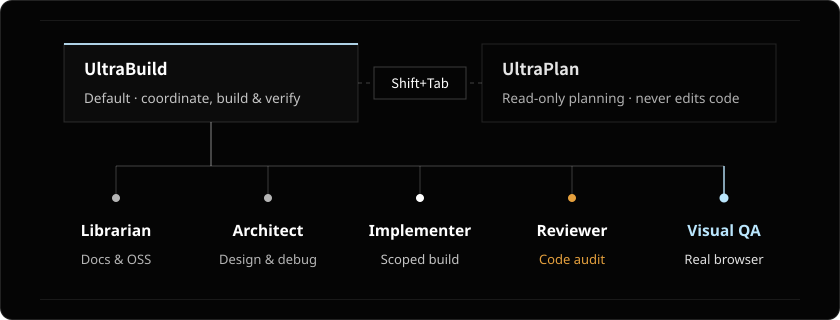

<div align="center">

<a href="https://ultracode.plutokeating.beer/es/">
  
</a>

<br />

[](https://github.com/PlutoKeating/Project.UltraCode/releases/latest)
[](https://ultracode.plutokeating.beer/es/)
[](https://ultracode.plutokeating.beer/es/docs/getting-started/)
[](https://github.com/PlutoKeating/Project.UltraCode/releases/tag/v0.3.0)
[](https://github.com/PlutoKeating/Project.UltraCode/actions/workflows/ci.yml)

[English](README.md) · [简体中文](README_ZH.md) · [العربية](README_AR.md) · [Français](README_FR.md) · [Русский](README_RU.md) · **Español**

[Sitio oficial](https://ultracode.plutokeating.beer/es/) • [Inicio rápido en 1 minuto](https://ultracode.plutokeating.beer/es/docs/getting-started/) • [Arquitectura](docs/ARCHITECTURE.md) • [Referencia CLI](docs/API.md)

</div>

**UltraCode (`v1.0.0`)** es una capa de mejora no invasiva y neutral frente a proveedores y modelos, construida sobre **OpenCode V2** oficial para **macOS, Linux y Windows** — unificada en **Terminal (TUI), aplicación de Escritorio, Web y Móvil**.

En lugar de adivinar antes de tiempo o perder el rumbo a mitad de una tarea compleja, UltraCode aclara los requisitos clave al inicio mediante tarjetas de opciones, delega la ejecución en especialistas en segundo plano, inspecciona la interfaz renderizada en un navegador Chromium real y guarda traspasos persistentes en tu repositorio.

> [!NOTE]
> **Construcción autoalojada:** UltraCode `v1.0.0` — incluido su runtime multisuperficie, su sitio en los 6 idiomas oficiales de la ONU y su flujo de publicación — fue desarrollado y construido con **UltraCode `v0.3.0`**.

## Descripción general

<div align="center">
  
</div>

### Capacidades clave

- **Un solo comando, cero requisitos previos**: el único comando `ultracode` es totalmente compatible con todas las banderas y subcomandos de `opencode`. El instalador y `ultracode upgrade` detectan, instalan o actualizan automáticamente OpenCode V2 oficial (`v2.3.2+`).
- **Sincronización en vivo en cada superficie**: el paquete integrado `ultracode-conversation` sincroniza el estado en tiempo real entre Server RPC, la paleta de comandos TUI, OpenCode Desktop (`ComposerPill` y `Settings → UltraCode`) y Web/Móvil (`/approvals` y `/direction`).
- **Dos roles principales + cinco especialistas**: cambia en cualquier momento con `Shift+Tab` entre `UltraBuild` (entrega de extremo a extremo) y `UltraPlan` (planificación de solo lectura), respaldados automáticamente por `librarian`, `architect`, `implementer`, `reviewer` y `visual-evaluator`.
- **Continuidad de tareas largas y reanudación limpia**: avanza hitos automáticamente, cede el control al instante cuando envías un nuevo mensaje y retoma el progreso tras reiniciar; incluye el ejecutor multiplataforma `ultracode ralph run`.
- **Estrictamente aditivo y reversible**: nunca modifica los binarios oficiales de OpenCode, nunca lee ni transmite tus claves API, conserva comentarios JSONC y skills personalizados, y se desinstala limpiamente.

<div align="center">
  
</div>

## Inicio rápido

### 1. Instalación en una línea

**macOS / Linux**:

```bash
curl -fsSL https://ultracode.plutokeating.beer/install.sh | bash
```

**Windows (PowerShell)**:

```powershell
irm https://ultracode.plutokeating.beer/install.ps1 | iex
```

> [!TIP]
> No necesitas instalar previamente Node.js, Bun ni OpenCode: si falta OpenCode V2 oficial, el script lo instala automáticamente desde el canal oficial.

### 2. Inicia en cualquier superficie

```bash
ultracode           # Abre la interfaz de terminal en el directorio actual
ultracode desktop   # Inicia OpenCode Desktop (o descarga el instalador oficial si falta)
ultracode pair      # Genera enlace y código QR para acceso desde navegador o móvil
```

- **Cambio de rol**: pulsa `Shift+Tab` para alternar entre `UltraBuild` (por defecto) y `UltraPlan` (solo lectura).
- **Interruptores en tiempo real**: alterna **Command approvals** (`auto` por defecto) y **Direction questions** (`manual` por defecto) desde la cápsula `UltraCode` en Desktop, `Settings → UltraCode`, la paleta TUI o `/approvals` y `/direction` en Web y Móvil.

## Referencia CLI

| Comando | Descripción |
| --- | --- |
| `ultracode [args...]` | Inicia OpenCode pasando directamente todas las banderas, rutas y subcomandos |
| `ultracode desktop` | Abre OpenCode Desktop oficial o descarga el instalador de tu plataforma |
| `ultracode pair [--remote]` | Vincula un navegador o dispositivo móvil mediante enlace y código QR |
| `ultracode upgrade` | Actualiza conjuntamente OpenCode V2 oficial y UltraCode y sincroniza ajustes |
| `ultracode sync` | Sincroniza de forma idempotente configuración, plugin, roles y runtime |
| `ultracode doctor` | Verifica versión, plugin, roles y MCP sin realizar llamadas a modelos |
| `ultracode ralph run <goal>` | Ejecuta iteraciones aisladas de Ralph en un linked Git worktree |
| `ultracode uninstall --yes` | Elimina UltraCode limpiamente conservando tus configuraciones y respaldos |

## Estructura del repositorio

```text
Project.UltraCode/
├── packages/
│   ├── installer/      # CLI unificado ultracode, fusión JSONC y compilador autónomo para 6 plataformas
│   ├── plugin-gui/     # Plugin gráfico de OpenCode Desktop (ComposerPill y SettingsPage)
│   └── config/         # Roles integrados de OpenCode, plugin Server/TUI/RPC y plantillas Ralph
├── scripts/            # Scripts de instalación sin requisitos previos (install.sh e install.ps1)
├── website/            # Sitio oficial y documentación Astro + Starlight en 6 idiomas
└── docs/               # Arquitectura, API, inicio rápido, despliegue en Cloudflare y recursos SVG
```

## Verificación local

```bash
bun install --cwd packages/plugin-gui
bun run --cwd packages/plugin-gui check
bun run --cwd packages/plugin-gui build

bun install --cwd packages/installer
bun test --cwd packages/installer
bun run --cwd packages/installer check
bun run --cwd packages/installer build

bun install --cwd website
bun run --cwd website check
bun run --cwd website build
```

> [!IMPORTANT]
> Las pruebas automatizadas se ejecutan íntegramente sobre directorios temporales aislados y stubs locales, sin invocar modelos reales ni leer credenciales personales.

## Documentación

- **Sitio oficial y guías** ([English](https://ultracode.plutokeating.beer) · [简体中文](https://ultracode.plutokeating.beer/zh/) · [العربية](https://ultracode.plutokeating.beer/ar/) · [Français](https://ultracode.plutokeating.beer/fr/) · [Русский](https://ultracode.plutokeating.beer/ru/) · [Español](https://ultracode.plutokeating.beer/es/))
- [Arquitectura](docs/ARCHITECTURE.md) · [Referencia CLI y RPC](docs/API.md) · [Inicio rápido](docs/QUICK_START.md) · [Despliegue en Cloudflare](docs/CLOUDFLARE.md)
- Índice legible por agentes de IA: [`llms.txt`](https://ultracode.plutokeating.beer/llms.txt) · [`llms-full.txt`](https://ultracode.plutokeating.beer/llms-full.txt)
