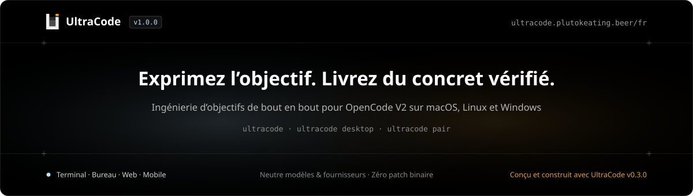
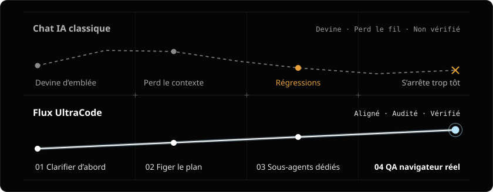
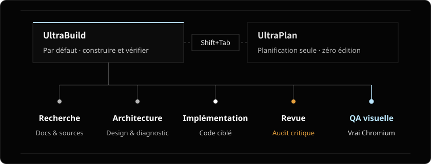

<div align="center">

<a href="https://ultracode.plutokeating.beer/fr/">
  
</a>

<br />

[](https://github.com/PlutoKeating/Project.UltraCode/releases/latest)
[](https://ultracode.plutokeating.beer/fr/)
[](https://ultracode.plutokeating.beer/fr/docs/getting-started/)
[](https://github.com/PlutoKeating/Project.UltraCode/releases/tag/v0.3.0)
[](https://github.com/PlutoKeating/Project.UltraCode/actions/workflows/ci.yml)

[English](README.md) · [简体中文](README_ZH.md) · [العربية](README_AR.md) · **Français** · [Русский](README_RU.md) · [Español](README_ES.md)

[Site officiel](https://ultracode.plutokeating.beer/fr/) • [Démarrage en 1 minute](https://ultracode.plutokeating.beer/fr/docs/getting-started/) • [Rôles & flux](https://ultracode.plutokeating.beer/fr/docs/roles-and-workflow/) • [Référence CLI](https://ultracode.plutokeating.beer/fr/docs/controls-and-maintenance/)

</div>

**UltraCode (`v1.0.0`)** est une couche d’enrichissement non invasive, neutre vis-à-vis des modèles et des fournisseurs, construite sur **OpenCode V2** officiel pour **macOS, Linux et Windows** — couvrant **Terminal (TUI), application Desktop, Web et Mobile**.

Au lieu de deviner trop tôt ou de perdre le contexte à mi-parcours, UltraCode clarifie les choix structurants dès le départ sous forme d’options claires, coordonne des spécialistes en arrière-plan, vérifie le rendu dans un vrai navigateur Chromium et sauvegarde des rapports de passation durables dans votre dépôt.

> [!NOTE]
> **Provenance d’ingénierie auto-hébergée :** UltraCode `v1.0.0` — y compris son runtime multi-surface, son site en 6 langues et sa chaîne de publication — a été développé et construit à l’aide d’**UltraCode `v0.3.0`**.

## Vue d’ensemble

<div align="center">
  
</div>

### Capacités clés

- **Une seule commande, zéro prérequis** : la commande unique `ultracode` transmet intégralement tous les arguments et sous-commandes d’`opencode`. L’installateur et `ultracode upgrade` détectent, installent ou mettent à jour automatiquement OpenCode V2 officiel (`v2.3.2+`).
- **Synchronisation en direct sur toutes les interfaces** : le plugin embarqué `ultracode-conversation` synchronise l’état entre Server RPC, la palette TUI, OpenCode Desktop (capsule rapide & page `Settings → UltraCode`) et Web/Mobile (`/approvals` et `/direction`).
- **Deux rôles principaux + cinq spécialistes** : basculez à tout moment via `Shift+Tab` entre `UltraBuild` (livraison complète) et `UltraPlan` (planification en lecture seule), épaulés automatiquement par `librarian`, `architect`, `implementer`, `reviewer` et `visual-evaluator`.
- **Continuité des tâches longues & reprise nette** : enchaîne les jalons automatiquement, vous redonne immédiatement la main dès qu’un message est envoyé et reprend après redémarrage ; inclut le lanceur multiplateforme `ultracode ralph run`.
- **Strictement additif & réversible** : ne modifie jamais les binaires officiels d’OpenCode, ne lit aucune clé API, préserve vos commentaires JSONC et skills existants, et se désinstalle proprement.

<div align="center">
  
</div>

## Démarrage rapide

### 1. Installation en une ligne

**macOS / Linux** :

```bash
curl -fsSL https://ultracode.plutokeating.beer/install.sh | bash
```

**Windows (PowerShell)** :

```powershell
irm https://ultracode.plutokeating.beer/install.ps1 | iex
```

> [!TIP]
> Aucun environnement Node.js, Bun ou OpenCode n’est requis au préalable : si OpenCode V2 officiel est absent, le script l’installe automatiquement depuis le canal officiel.

### 2. Lancement sur n’importe quelle surface

```bash
ultracode           # Ouvrir l’interface terminal dans le dossier courant
ultracode desktop   # Lancer OpenCode Desktop (ou télécharger l’installateur officiel)
ultracode pair      # Générer un lien et un QR code pour navigateur ou mobile
```

- **Changement de rôle** : appuyez sur `Shift+Tab` pour passer entre `UltraBuild` (par défaut) et `UltraPlan` (planification seule).
- **Interrupteurs temps réel** : basculez **l’approbation des commandes** (`auto` par défaut) et **les questions d’orientation** (`manual` par défaut) depuis la capsule `UltraCode` sur Desktop, `Settings → UltraCode`, la palette TUI ou `/approvals` et `/direction` sur Web et Mobile.

## Référence CLI

| Commande | Description |
| --- | --- |
| `ultracode [args...]` | Lance OpenCode avec transmission intégrale des options et sous-commandes |
| `ultracode desktop` | Ouvre OpenCode Desktop ou télécharge l’installateur officiel de la plateforme |
| `ultracode pair [--remote]` | Associe un navigateur ou un téléphone via lien et QR code |
| `ultracode upgrade` | Met à jour OpenCode V2 officiel et UltraCode puis synchronise la configuration |
| `ultracode sync` | Synchronise de manière idempotente la configuration, le plugin et les rôles |
| `ultracode doctor` | Vérifie l’installation sans effectuer le moindre appel à un modèle IA |
| `ultracode ralph run <goal>` | Exécute la boucle Ralph en sessions isolées dans un arbre de travail Git lié |
| `ultracode uninstall --yes` | Supprime proprement UltraCode tout en conservant vos réglages et sauvegardes |

## Architecture du dépôt

```text
Project.UltraCode/
├── packages/
│   ├── installer/      # CLI unifiée ultracode, fusion JSONC & compilation autonome 6 plateformes
│   ├── plugin-gui/     # Plugin graphique OpenCode Desktop (capsule rapide & page de réglages)
│   └── config/         # Rôles OpenCode embarqués, plugin Server/TUI/RPC & modèles Ralph
├── scripts/            # Scripts d’installation (install.sh, install.ps1) & générateur SVG/OG 6 langues
├── website/            # Site officiel & documentation Astro + Starlight en 6 langues
└── docs/               # Architecture, référence API, démarrage rapide, déploiement Cloudflare & SVG 6 langues
```

## Vérification locale

```bash
bun install --cwd packages/plugin-gui
bun run --cwd packages/plugin-gui check
bun run --cwd packages/plugin-gui build

bun install --cwd packages/installer
bun test --cwd packages/installer
bun run --cwd packages/installer check
bun run --cwd packages/installer build

bun install --cwd website
bun run --cwd website check
bun run --cwd website build
```

> [!IMPORTANT]
> Les tests automatisés s’exécutent intégralement dans des répertoires temporaires isolés, sans jamais appeler de modèles réels ni lire d’identifiants utilisateur.

## Documentation

- **Site officiel & guides** ([English](https://ultracode.plutokeating.beer) · [简体中文](https://ultracode.plutokeating.beer/zh/) · [العربية](https://ultracode.plutokeating.beer/ar/) · [Français](https://ultracode.plutokeating.beer/fr/) · [Русский](https://ultracode.plutokeating.beer/ru/) · [Español](https://ultracode.plutokeating.beer/es/))
- [Démarrage rapide](https://ultracode.plutokeating.beer/fr/docs/getting-started/) · [Ingénierie d’objectifs](https://ultracode.plutokeating.beer/fr/docs/goal-engineering/) · [Rôles & flux](https://ultracode.plutokeating.beer/fr/docs/roles-and-workflow/) · [Contrôles & CLI](https://ultracode.plutokeating.beer/fr/docs/controls-and-maintenance/) · [FAQ](https://ultracode.plutokeating.beer/fr/docs/faq/)
- Index lisible par les agents IA : [`llms.txt`](https://ultracode.plutokeating.beer/llms.txt) · [`llms-full.txt`](https://ultracode.plutokeating.beer/llms-full.txt)
