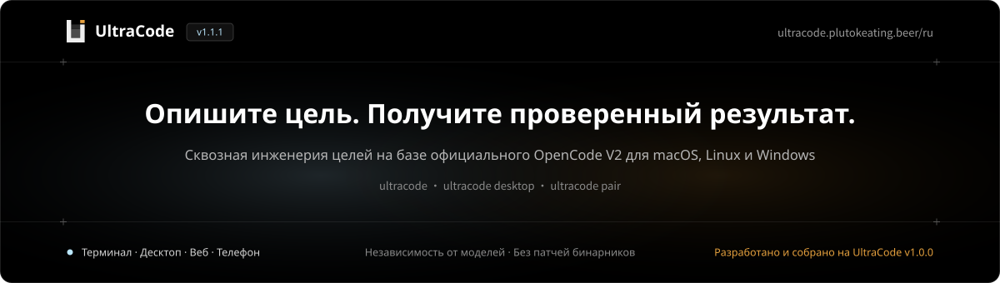
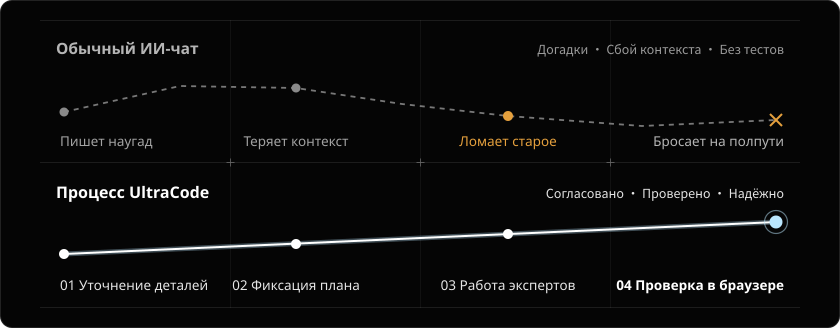
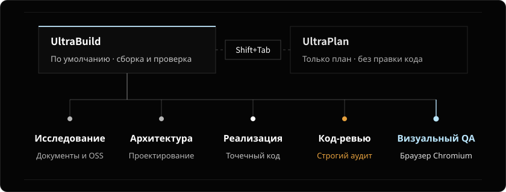

<div align="center">

<a href="https://ultracode.plutokeating.beer/ru/">
  
</a>

<br />

[](https://github.com/PlutoKeating/Project.UltraCode/releases/latest)
[](https://ultracode.plutokeating.beer/ru/)
[](https://ultracode.plutokeating.beer/ru/docs/getting-started/)
[](https://github.com/PlutoKeating/Project.UltraCode/releases/tag/v0.3.0)
[](https://github.com/PlutoKeating/Project.UltraCode/actions/workflows/ci.yml)

[English](README.md) · [简体中文](README_ZH.md) · [العربية](README_AR.md) · [Français](README_FR.md) · **Русский** · [Español](README_ES.md)

[Официальный сайт](https://ultracode.plutokeating.beer/ru/) • [Быстрый старт за 1 минуту](https://ultracode.plutokeating.beer/ru/docs/getting-started/) • [Роли и процесс](https://ultracode.plutokeating.beer/ru/docs/roles-and-workflow/) • [Справочник CLI](https://ultracode.plutokeating.beer/ru/docs/controls-and-maintenance/)

</div>

**UltraCode (`v1.0.0`)** — это неинвазивная, независимая от провайдеров и моделей надстройка **Goal Engineering** поверх официального **OpenCode V2** для **macOS, Linux и Windows**, охватывающая **терминал (TUI), десктопное приложение, веб-интерфейс и мобильные устройства**.

Вместо поспешных догадок и потери контекста на длинных задачах UltraCode заранее уточняет ключевые развилки карточками выбора, распределяет задачи между профильными фоновыми агентами, проверяет вёрстку и сценарии в реальном браузере Chromium и сохраняет прогресс в репозитории.

> [!NOTE]
> **Разработка на собственном стеке:** релиз UltraCode `v1.0.0` (включая кроссплатформенный рантайм, сайт и документацию на 6 языках ООН) разработан и собран с помощью **UltraCode `v0.3.0`**.

## Обзор

<div align="center">
  
</div>

### Ключевые возможности

- **Одна команда, ноль предварительных зависимостей**: единая команда `ultracode` полностью совместима со всеми флагами и подкомандами `opencode`. Установщик и `ultracode upgrade` автоматически устанавливают или обновляют официальный OpenCode V2 (`v2.3.2+`).
- **Синхронизация на всех платформах**: встроенный пакет плагина `ultracode-conversation` синхронизирует режимы в реальном времени между Server RPC, палитрой команд TUI, OpenCode Desktop (`ComposerPill` и `Settings → UltraCode`) и веб/мобильным клиентом (`/approvals` и `/direction`).
- **Две основные роли + пять профильных экспертов**: переключайтесь по `Shift+Tab` между `UltraBuild` (сквозная реализация) и `UltraPlan` (планирование только для чтения), которым автоматически помогают `librarian`, `architect`, `implementer`, `reviewer` и `visual-evaluator`.
- **Долгие задачи и бесшовное продолжение**: автоматически продвигается по этапам, мгновенно уступает управление при новом сообщении и продолжает работу после перезапуска; включает кроссплатформенный `ultracode ralph run`.
- **Бережная интеграция и чистое удаление**: не изменяет официальные бинарные файлы OpenCode, не читает ваши API-ключи, сохраняет комментарии JSONC и пользовательские навыки.

<div align="center">
  
</div>

## Быстрый старт

### 1. Установка одной строкой

**macOS / Linux**:

```bash
curl -fsSL https://ultracode.plutokeating.beer/install.sh | bash
```

**Windows (PowerShell)**:

```powershell
irm https://ultracode.plutokeating.beer/install.ps1 | iex
```

> [!TIP]
> Предварительная установка Node.js, Bun или OpenCode не требуется: если официальный OpenCode V2 отсутствует, скрипт автоматически установит его из официального канала.

### 2. Запуск в удобном интерфейсе

```bash
ultracode           # Открыть терминальный интерфейс в текущей папке
ultracode desktop   # Запустить OpenCode Desktop (или скачать официальный установщик)
ultracode pair      # Сгенерировать ссылку и QR-код для браузера или телефона
```

- **Переключение ролей**: нажмите `Shift+Tab` для переключения между `UltraBuild` (по умолчанию) и `UltraPlan` (только планирование).
- **Живые переключатели**: управляйте **Command approvals** (по умолчанию `auto`) и **Direction questions** (по умолчанию `manual`) через капсулу `UltraCode` в Desktop, `Settings → UltraCode`, палитру команд TUI или команды `/approvals` и `/direction` в браузере и на телефоне.

## Справочник команд CLI

| Команда | Описание |
| --- | --- |
| `ultracode [args...]` | Запуск OpenCode с прямой передачей всех аргументов, путей и подкоманд |
| `ultracode desktop` | Запуск официального OpenCode Desktop или загрузка установщика для вашей ОС |
| `ultracode pair [--remote]` | Подключение браузера или мобильного устройства по ссылке и QR-коду |
| `ultracode upgrade` | Совместное обновление OpenCode V2 и UltraCode с синхронизацией настроек |
| `ultracode sync` | Идемпотентная синхронизация конфигурации, плагина, ролей и рантайма |
| `ultracode doctor` | Быстрая диагностика окружения без единого вызова ИИ-моделей |
| `ultracode ralph run <goal>` | Запуск изолированного цикла Ralph в выделенном linked Git worktree |
| `ultracode uninstall --yes` | Чистое удаление UltraCode с сохранением ваших настроек и резервных копий |

## Структура репозитория

```text
Project.UltraCode/
├── packages/
│   ├── installer/      # Единый CLI ultracode, слияние JSONC и кросс-компиляция под 6 платформ
│   ├── plugin-gui/     # GUI-плагин для OpenCode Desktop (ComposerPill и SettingsPage)
│   └── config/         # Роли OpenCode, плагин синхронизации Server/TUI/RPC и шаблоны Ralph
├── scripts/            # Скрипты установки без зависимостей (install.sh и install.ps1)
├── website/            # Официальный сайт и документация на Astro + Starlight (6 языков)
└── docs/               # Архитектура, API, быстрый старт, деплой в Cloudflare и общие SVG
```

## Локальная проверка

```bash
bun install --cwd packages/plugin-gui
bun run --cwd packages/plugin-gui check
bun run --cwd packages/plugin-gui build

bun install --cwd packages/installer
bun test --cwd packages/installer
bun run --cwd packages/installer check
bun run --cwd packages/installer build

bun install --cwd website
bun run --cwd website check
bun run --cwd website build
```

> [!IMPORTANT]
> Все автоматические тесты выполняются во временных изолированных директориях с заглушками — без обращения к реальным моделям и без чтения личных ключей.

## Документация

- **Официальный сайт и руководства** ([English](https://ultracode.plutokeating.beer) · [简体中文](https://ultracode.plutokeating.beer/zh/) · [العربية](https://ultracode.plutokeating.beer/ar/) · [Français](https://ultracode.plutokeating.beer/fr/) · [Русский](https://ultracode.plutokeating.beer/ru/) · [Español](https://ultracode.plutokeating.beer/es/))
- [Быстрый старт](https://ultracode.plutokeating.beer/ru/docs/getting-started/) · [Инженерия целей](https://ultracode.plutokeating.beer/ru/docs/goal-engineering/) · [Роли и эксперты](https://ultracode.plutokeating.beer/ru/docs/roles-and-workflow/) · [Управление и CLI](https://ultracode.plutokeating.beer/ru/docs/controls-and-maintenance/) · [FAQ](https://ultracode.plutokeating.beer/ru/docs/faq/)
- Индекс для ИИ-агентов: [`llms.txt`](https://ultracode.plutokeating.beer/llms.txt) · [`llms-full.txt`](https://ultracode.plutokeating.beer/llms-full.txt)
