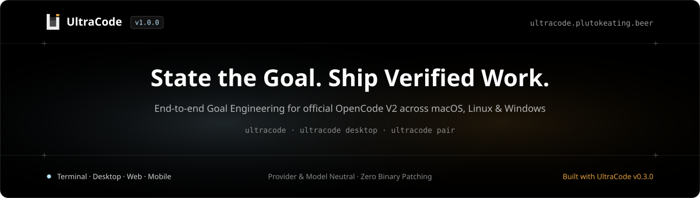
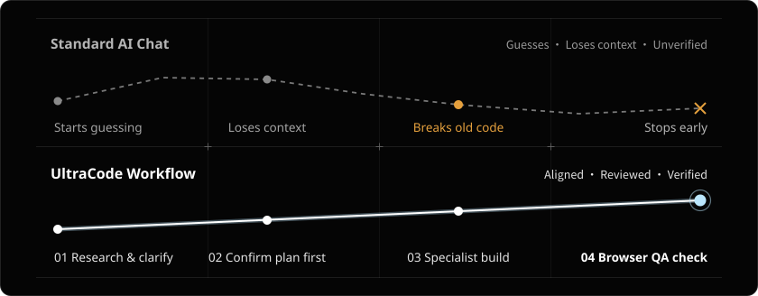
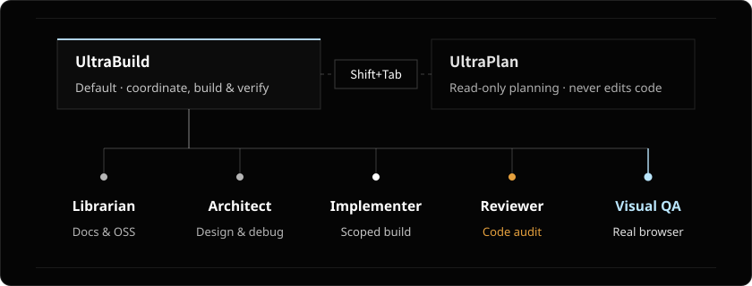

<div align="center">

<a href="https://ultracode.plutokeating.beer/zh/">
  
</a>

<br />

[](https://github.com/PlutoKeating/Project.UltraCode/releases/latest)
[](https://ultracode.plutokeating.beer/zh/)
[](https://ultracode.plutokeating.beer/zh/docs/getting-started/)
[](https://github.com/PlutoKeating/Project.UltraCode/releases/tag/v0.3.0)
[](https://github.com/PlutoKeating/Project.UltraCode/actions/workflows/ci.yml)

[English](README.md) · **简体中文** · [العربية](README_AR.md) · [Français](README_FR.md) · [Русский](README_RU.md) · [Español](README_ES.md)

[官方网站](https://ultracode.plutokeating.beer/zh/) • [1 分钟上手指南](https://ultracode.plutokeating.beer/zh/docs/getting-started/) • [系统架构](docs/ARCHITECTURE.md) • [命令参考](docs/API.md)

</div>

**UltraCode（`v1.0.0`）** 是面向官方 **OpenCode V2** 的模型与服务商中立增强层，聚焦 **Goal Engineering（目标工程）**——让你用自然语言说清受众、核心行为与验收标准，把前置调研确认、多角色分工实现、独立代码复核与真实浏览器页面检查串联为稳定闭环，原生支持 **macOS、Linux 与 Windows**，打通 **终端（TUI）、桌面端（Desktop）、网页端（Web）与手机端（Mobile）**。

> [!NOTE]
> **自举开发与构建说明**：UltraCode `v1.0.0` 正式版（涵盖多触点运行时、6 国语言官网文档与构建发布链路）均使用 **UltraCode `v0.3.0`** 辅助开发与构建完成。

## 核心概览

<div align="center">
  
</div>

### 核心特性

- **单一命令与零前置安装**：唯一命令 `ultracode` 与官方 `opencode` 参数和子命令完全互通；安装脚本与 `ultracode upgrade` 会自动检测并安装或更新官方 OpenCode V2（`v2.3.2+`）。
- **全端实时同步体验**：内嵌 `ultracode-conversation` 多触点插件包，打通 Server RPC、TUI 命令面板、OpenCode Desktop（输入框上方 `UltraCode` 胶囊与 `Settings → UltraCode` 设置页）及网页/手机端（`/approvals` 与 `/direction`）。
- **双主角色与五位后台专家**：按 `Shift+Tab` 在默认总控 `UltraBuild` 与只读规划 `UltraPlan` 之间随时切换，后台自动按需调度 `librarian`、`architect`、`implementer`、`reviewer` 与 `visual-evaluator`。
- **长任务持续推进与断点恢复**：在当前会话内自动衔接阶段目标，发新消息随时插话转向；进度与交接记录保存在仓库内，重启后可自然语言接续，并内置跨平台 TypeScript 原生 `ultracode ralph run`。
- **纯增量且随时可逆**：不修改官方 OpenCode 二进制程序，不读取或上传任何 API 密钥，完整保留原有 JSONC 注释、快捷键与自定义技能，支持一键干净卸载。

<div align="center">
  
</div>

## 快速开始

### 1. 一条命令安装

**macOS / Linux**：

```bash
curl -fsSL https://ultracode.plutokeating.beer/install.sh | bash
```

**Windows（PowerShell）**：

```powershell
irm https://ultracode.plutokeating.beer/install.ps1 | iex
```

> [!TIP]
> 无需预先安装 Node.js、Bun 或 OpenCode。若当前环境尚未安装官方 OpenCode V2，安装脚本会自动通过官方渠道完成安装。

### 2. 选择任意入口启动

```bash
ultracode           # 在当前目录启动终端界面
ultracode desktop   # 打开官方桌面客户端（未安装时自动下载官方安装包）
ultracode pair      # 生成配对链接与二维码，接入浏览器或手机端
```

- **切换主角色**：默认进入 `UltraBuild`；按 `Shift+Tab` 切换至纯只读规划角色 `UltraPlan`。
- **实时切换双开关**：通过 OpenCode Desktop 输入框上方 **UltraCode** 胶囊、`Settings → UltraCode`、TUI 命令面板，或在网页/手机端输入 `/approvals`、`/direction`，实时切换 **Command approvals**（默认 `auto`）与 **Direction questions**（默认 `manual`）。

## 常用命令参考

| 命令 | 说明 |
| --- | --- |
| `ultracode [args...]` | 启动终端界面，原样透传所有官方 `opencode` 参数、路径与子命令 |
| `ultracode desktop` | 启动已安装的官方 OpenCode Desktop，或下载当前平台官方安装包 |
| `ultracode pair [--remote]` | 输出浏览器与手机端配对链接及二维码 |
| `ultracode upgrade` | 一键更新官方 OpenCode V2 与 UltraCode 并自动同步配置 |
| `ultracode sync` | 幂等同步配置、多触点插件、角色与受管运行时 |
| `ultracode doctor` | 零模型调用快速检查版本、插件、角色与 MCP 状态 |
| `ultracode ralph run <goal>` | 在专用 linked Git worktree 中运行跨会话隔离的 Ralph 循环 |
| `ultracode uninstall --yes` | 干净移除 UltraCode 受管文件与二进制（保留个人配置与备份） |

## 项目目录架构

```text
Project.UltraCode/
├── packages/
│   ├── installer/      # 统一 ultracode CLI、JSONC 无损合并器与 6 平台交叉构建脚本
│   ├── plugin-gui/     # OpenCode Desktop 桌面端插件源码（ComposerPill 与独立设置页）
│   └── config/         # 内嵌 OpenCode 角色、Server/TUI/RPC 多端同步插件与 Ralph 模板
├── scripts/            # 零前置一键安装脚本（install.sh 与 install.ps1）
├── website/            # Astro + Starlight 6 国语言官网与文档站点（ultracode.plutokeating.beer）
└── docs/               # 架构设计、命令接口、快速开始、Cloudflare 部署指南与共享 SVG 资产
```

## 本地开发与验证

```bash
bun install --cwd packages/plugin-gui
bun run --cwd packages/plugin-gui check
bun run --cwd packages/plugin-gui build

bun install --cwd packages/installer
bun test --cwd packages/installer
bun run --cwd packages/installer check
bun run --cwd packages/installer build

bun install --cwd website
bun run --cwd website check
bun run --cwd website build
```

> [!IMPORTANT]
> 所有自动化测试均在隔离临时目录与本地桩程序上执行，绝不调用真实大模型或读取用户凭据。

## 更多文档

- **多语言官方网站与教程**（[English](https://ultracode.plutokeating.beer) · [简体中文](https://ultracode.plutokeating.beer/zh/) · [العربية](https://ultracode.plutokeating.beer/ar/) · [Français](https://ultracode.plutokeating.beer/fr/) · [Русский](https://ultracode.plutokeating.beer/ru/) · [Español](https://ultracode.plutokeating.beer/es/)）
- [架构文档](docs/ARCHITECTURE.md) · [命令接口](docs/API.md) · [快速开始](docs/QUICK_START.md) · [Cloudflare 部署](docs/CLOUDFLARE.md)
- 面向 AI Agent 的标准检索索引：[`llms.txt`](https://ultracode.plutokeating.beer/llms.txt) · [`llms-full.txt`](https://ultracode.plutokeating.beer/llms-full.txt)
